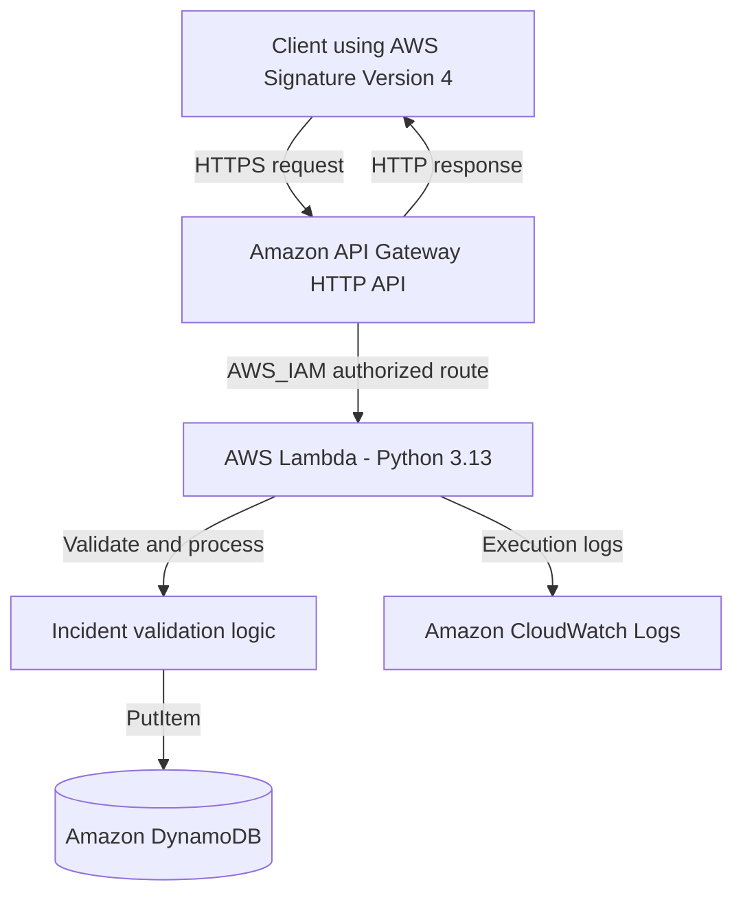

# AWS Serverless Incident Reporting API

A serverless REST API built with AWS API Gateway, AWS Lambda, and Amazon DynamoDB. The application accepts incident reports, validates the submitted data, and stores valid incidents in a DynamoDB table.

This project demonstrates practical AWS cloud engineering skills, including serverless architecture, IAM permissions, API authentication, Python development, automated testing, AWS CLI deployment, and cloud logging.

## Architecture



### Request flow

1. A client sends a signed HTTPS request to API Gateway.
2. API Gateway authorizes the request using AWS IAM.
3. API Gateway invokes the Lambda function.
4. Lambda validates the incident data.
5. Valid incidents are assigned a unique ID, an `open` status, and a creation timestamp.
6. Lambda saves the incident to DynamoDB.
7. The API returns a JSON response to the client.

## AWS Services and Technologies

- **Amazon API Gateway HTTP API** — exposes the health-check and incident-creation routes.
- **AWS Lambda** — runs the Python application without managing servers.
- **Amazon DynamoDB** — stores incident records.
- **AWS IAM** — controls API access, Lambda execution permissions, and service invocation.
- **Amazon CloudWatch Logs** — collects Lambda execution logs.
- **AWS CLI** — used to inspect, configure, deploy, and test AWS resources.
- **Python** — application logic and unit tests.
- **Git and GitHub** — source control and project documentation.

## API Endpoints

The deployed API uses the `prod` stage.

| Method | Endpoint | Purpose |
|---|---|---|
| GET | `/prod/health` | Returns the API health status |
| POST | `/prod/incidents` | Validates and creates an incident |

Both routes require AWS IAM authorization. Requests must be signed using AWS Signature Version 4.

### Health check

Example request:

```bash
awscurl --service execute-api --region af-south-1 \
  "https://4d4uoeihp0.execute-api.af-south-1.amazonaws.com/prod/health"
```

Example response:

```json
{"status": "ok"}
```

### Create an incident

Example request:

```bash
awscurl --service execute-api --region af-south-1 \
  -X POST \
  -H "Content-Type: application/json" \
  -d '{"title":"Website unavailable","description":"The website is not responding","severity":"high","reporter":"Example User"}' \
  "https://4d4uoeihp0.execute-api.af-south-1.amazonaws.com/prod/incidents"
```

The example uses placeholder incident information. Replace it with appropriate test data.

Valid severity values are:

- `low`
- `medium`
- `high`
- `critical`

A successful request returns the created incident, including its unique `incidentId`, status, and timestamp.

## Incident Data Model

The DynamoDB table is named `IncidentReports`.

| Attribute | Description |
|---|---|
| `incidentId` | Unique incident identifier and table partition key |
| `title` | Short incident title |
| `description` | Incident details |
| `severity` | `low`, `medium`, `high`, or `critical` |
| `reporter` | Name or identifier supplied by the reporter |
| `status` | Initial status, `open` |
| `createdAt` | UTC timestamp when the incident is created |

The table uses on-demand (`PAY_PER_REQUEST`) billing.

## Repository Structure

```text
aws-serverless-incident-api/
├── infrastructure/
│   ├── lambda-permissions-policy.json
│   └── lambda-trust-policy.json
├── src/
│   └── lambda_function.py
├── tests/
│   └── test_lambda_function.py
├── test_lambda.py
├── .gitignore
└── README.md
```

The `build/` directory contains generated deployment artifacts and is excluded from Git.

## Local Setup and Testing

### Prerequisites

- Python 3.13 or a compatible local Python environment
- AWS CLI
- AWS credentials configured securely
- `awscurl` for signed API requests
- Git

### Set up the Python environment

From the project root:

```bash
python3 -m venv .venv
source .venv/bin/activate
```

Install any required test dependencies if your test suite uses them. The Lambda application uses Python's standard library and the AWS SDK provided by the Lambda runtime for its DynamoDB integration.

### Run the tests

```bash
python test_lambda.py
```

The local test suite covers:

- Valid incident creation
- Invalid severity
- Missing request body
- Health check
- Missing table configuration
- Simulated database failure

All six tests passed during project verification.

## Deployment Overview

The application was deployed to AWS in the `af-south-1` region.

The deployed resources include:

- API Gateway HTTP API: `IncidentReportsAPI`
- Lambda function: `IncidentReportsFunction`
- DynamoDB table: `IncidentReports`
- IAM execution role: `IncidentApiLambdaRole`
- IAM permissions policy: `IncidentApiLambdaPermissions`
- API stage: `prod`

The Lambda deployment package contains `lambda_function.py` at the root of the ZIP file.

The deployment process involved:

1. Creating the DynamoDB table and IAM execution role.
2. Deploying the Lambda function with its table-name environment variable.
3. Creating the API Gateway integration and routes.
4. Configuring IAM authorization and Lambda invocation permission.
5. Testing the live API and verifying persisted records in DynamoDB.

Resource creation and deployment commands should be adapted to the target AWS account. Do not assume the resources already exist in a new environment.

## Security Decisions

- Both API routes require AWS IAM authorization.
- Requests are signed using AWS Signature Version 4.
- Lambda uses a dedicated execution role rather than hard-coded AWS credentials.
- DynamoDB write access is restricted to `dynamodb:PutItem` on the `IncidentReports` table in the reviewed permissions policy.
- CloudWatch logging permissions are scoped to the Lambda function's log group in that policy.
- Lambda invocation permission identifies API Gateway as the allowed service and scopes the source ARN to this API.
- Temporary diagnostic logging of complete API Gateway events was removed to avoid logging sensitive request headers.
- Local credentials, environment files, Python environments, and build artifacts are excluded from Git.

The API Gateway invocation permission currently permits any stage, method, and route within the specified API at the Lambda resource-policy level. The routes independently require IAM authorization. Restricting the invocation source ARN further is a potential hardening improvement.

DynamoDB encrypts table data at rest by default. The table's `SSEDescription` query returned `null`, so the output did not independently confirm its specific encryption configuration.

## Testing and Verification Results

The following checks were completed:

- All six local Lambda tests passed.
- The live health endpoint returned `{"status":"ok"}`.
- A valid incident was created through API Gateway.
- The created incident was retrieved from DynamoDB using its `incidentId`.
- Invalid severity was rejected with a validation error.
- The deployed Lambda configuration and IAM policies were inspected.
- Both API routes were confirmed to use `AWS_IAM` authorization.
- DynamoDB deletion protection was enabled.

## Troubleshooting Lessons

### Health-check route mismatch

The initial health check failed because API Gateway included the stage prefix in `rawPath`, resulting in `/prod/health` rather than `/health`.

The handler was updated to check the route key (`GET /health`) as well as the raw path. The health check then succeeded.

### Verifying database persistence

A successful API response alone is not sufficient proof that data was persisted. The incident was independently retrieved from DynamoDB using the AWS CLI.

### Signed API requests

Because the routes use `AWS_IAM`, unsigned requests are not appropriate for testing. `awscurl` was used to sign API requests with AWS Signature Version 4.

## Cost Considerations and Cleanup

This project uses serverless services and DynamoDB on-demand billing to avoid managing always-running application servers.

Potential charges may still arise from:

- API Gateway requests
- Lambda invocations and execution duration
- DynamoDB reads, writes, and storage
- CloudWatch log ingestion and retention
- Other resources retained in the AWS account

Actual cost depends on usage, regional pricing, account eligibility, and any applicable credits.

Before cleaning up the project:

1. Check AWS Billing and Cost Explorer for ongoing charges.
2. Remove the API Gateway API when it is no longer needed.
3. Remove the Lambda function and its dedicated IAM resources when safe to do so.
4. Disable DynamoDB deletion protection before deleting the table.
5. Delete the DynamoDB table only after confirming its records are no longer needed.
6. Review CloudWatch log groups and remove them if no longer needed.
7. Verify that no project resources remain that could incur charges.

Do not delete shared IAM resources or resources belonging to other projects.

## Future Improvements

- Add a `GET /incidents/{incidentId}` endpoint with narrowly scoped DynamoDB read access.
- Add pagination for listing incidents.
- Introduce structured logging with sensitive-field redaction.
- Add integration tests and automated deployment through GitHub Actions.
- Add infrastructure as code using AWS SAM, CloudFormation, or Terraform.
- Add alarms and metrics for Lambda errors and API failures.
- Add request throttling and additional validation for production use.

## What I Learned

- How API Gateway, Lambda, and DynamoDB work together in a serverless application.
- How to use IAM trust policies, execution policies, and resource-based Lambda permissions.
- How to protect API routes with AWS IAM authorization.
- How to package and deploy Python Lambda code with the AWS CLI.
- How to validate API requests and test error conditions.
- How to verify DynamoDB persistence independently of an API response.
- How to troubleshoot API Gateway path behavior and improve security by removing sensitive diagnostic logging.

---

**Project status:** Deployed and functionally verified in AWS. This is a learning and portfolio project, not a production incident-management system.
